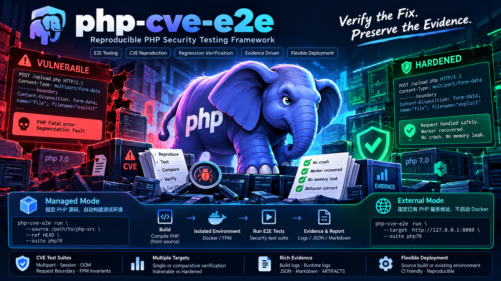
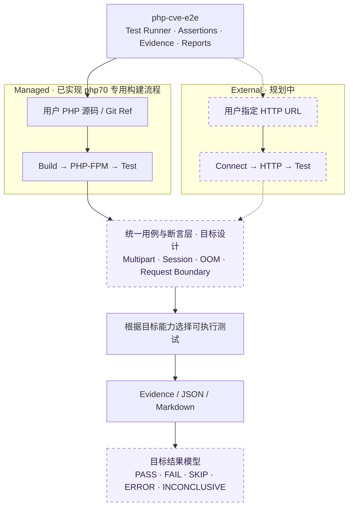

<p align="center">
  
</p>

<h1 align="center">php-cve-e2e</h1>
<p align="center"><strong>Verify the fix. Preserve the evidence.</strong><br>PHP 安全修复的端到端对照测试与请求生命周期验证工具</p>

<p align="center">
  
  
  
  
</p>

<p align="center">
  <a href="#架构">架构</a> · <a href="#快速开始">快速开始</a> · <a href="#验证什么">验证什么</a> · <a href="#两种报告模式">报告模式</a> · <a href="#实测差异">实测差异</a> · <a href="#参考资料">参考资料</a>
</p>

---

**同一份源码、同一组请求，对比修复前后的真实行为。**

`php-cve-e2e` 面向 PHP 安全回移植的开发者、审查者和维护者：检查缓解是否生效、异常请求后 worker 如何退出或复用，以及普通上传、session 和 fatal 语义有没有回归。

首个套件是 **PHP 7.0.33**，验证 CVE-2026-109618 / CVE-2026-109619 的**非官方 PHP 7.0 EOL 最小缓解适配**。测试目标参考官方 PHP 7.4 EOL 补丁；它不等同于受支持 PHP 8 的完整修复，也不意味着 PHP 7.0 恢复官方支持。[官方公告](https://www.php.net/archive/2026.php#2026-10-21-5) · [PHP 7.4 最小缓解](https://github.com/php/php-src/commit/712e60f9edfd03f0960fc4fc3c2c375f42b90aa2)

本工具提供隔离测试、行为门禁与证据报告，不包含完整 RCE 利用链。当前没有 PHP 8 测试套件；后续版本按独立目录扩展。

## 架构

**测试目标由用户提供，测试环境可以由工具管理，测试证据必须独立可信。**

下面展示目标架构，以及当前已落地的部分。Managed 与 External 描述环境如何接入；插桩与非插桩描述如何取得证据，这是两个不同维度。



| 层 | 职责 | 当前状态 |
|---|---|---|
| Managed | 接收源码与 Git Ref，构建 PHP、启动隔离 FPM 并执行测试 | 已实现 php70 专用流程；仍要求适配分支的安全编译开关及固定三构建对照 |
| External | 连接用户已有 HTTP 服务，运行目标允许的用例 | 规划中，尚无 HTTP runner；需要服务端探针与能力识别 |
| 用例与断言 | 组织 multipart、session、OOM 和请求边界检查 | 已有 FPM/native/trace 检查；统一可复用用例层尚未抽取 |
| 能力选择 | 依据服务端探针、进程可见性及故障注入能力选择测试 | 目标设计；缺少证据的检查不能自动视为通过 |
| 证据与报告 | 保存来源、日志、观察结果与判断依据 | 已有 JSON 和 Markdown 实测报告；统一五状态模型规划中，当前主要使用 `pass` / `completed` 与局部 skip/error 字段 |

### 按目标能力决定验证范围

Managed 能控制构建和 FPM 进程，因此可以检查 master/child 状态、加载测试扩展，并在专用构建中插桩。External 将通过 HTTP 连接已有环境，不负责启动 Docker 或管理服务端进程。

External 的 multipart/session 等检查需要相应 PHP 探针；worker PID 需要服务端证据，FPM master、native allocator 和 C 层时序通常无法从普通 URL 获得。**HTTP 502、断线或缺少日志不能直接证明 worker 按修复预期退出。** OOM 等故障注入也必须由目标能力与执行策略单独决定。

头图展示的是上述架构愿景。图中的统一 `php-cve-e2e run` CLI、External 模式尚未实现；当前可执行入口以[快速开始](#快速开始)为准。图中的 “No memory leak” 是示意文案，本仓库现有报告不提供零泄漏证明。

## 验证什么

| 路径 | 检查内容 | hardened 的要求 |
|---|---|---|
| 上传进度消费者 / 109619 | 配置请求开启 progress；普通 multipart 与 `PHP_VALUE` 再开启 | session 中不出现 `upload_progress_*` |
| 脚本期 OOM / 109618 | 有界分配失败、shutdown/析构标记、FPM 日志和 PID | worker `exit 1`，无用户清理标记，master 存活并拉起新 worker |
| 启动期 OOM | multipart 解析阶段超过 Zend `memory_limit` | 原 worker 退出，新 worker 能继续处理正常 session |
| allocator 边界 | 独立测试扩展触发分配/溢出失败入口 | `exit 1`，不执行 PHP shutdown/析构或 C `atexit` 回调 |
| 请求边界 | 普通 fatal 后同 worker 的 handler 和 HTTP globals 可观察状态 | 与基线一致、没有测试污染标记残留 |
| 正常功能 | 文件内容、表单字段、session 连续读写、普通 fatal | 保留既有行为 |
| C 层时序 | multipart callback、session 消费入口、真实模块 RINIT | 受测请求中 RINIT 前的 session 消费被阻断 |

普通 fatal 与 OOM 分开验证。hardened OOM 后 worker 应退出，因此验证的是**新 worker 状态干净**；同 PID 连续请求检查用于普通 fatal 路径。

## 快速开始

需要 Docker、Git 和 Python 3。宿主机不需要安装 PHP 7.0，也不需要 Python 第三方依赖。

### 1. 准备工具与受测分支

```sh
git clone https://github.com/fangfengxiang/php-cve-e2e.git
git clone --branch security/php70-cve-2026-109618-109619 \
  https://github.com/fangfengxiang/php-src.git
cd php-cve-e2e
```

工具会归档指定源码的 **Git 提交**，拒绝脏工作区。`php70` 套件要求源码提供 `--enable-php70-security` / `--disable-php70-security` 编译选项；未经适配的官方 PHP 7.0 源码不能直接作为 hardened 输入。

### 2. 非插桩：构建并运行行为对照

```sh
./php70/run.sh --source ../php-src \
  --output "$PWD/artifacts/behavior-001" --jobs 4
```

首次构建工具链镜像会下载依赖。此后的 PHP 编译和测试均在 `--network none` 容器中进行，以私有 FastCGI Unix socket 驱动 FPM，不开放 HTTP 端口。

工具依次编译固定 **baseline**、分支 **legacy** 和分支 **hardened**，然后运行 FPM 与 native 检查。FPM 固定单 worker，`pm.max_requests=0`，避免请求分配或自动轮换造成 PID 假差异。

### 3. 插桩：观察 C 层真实调用顺序

```sh
python3 php70/trace-run.py --source ../php-src \
  --image php-cve-e2e:php70 \
  --output "$PWD/artifacts/trace-001" --jobs 4
```

这一步复用上一步的工具链镜像，在**独立源码副本**中插入 C 观察点，重新编译 legacy/hardened；原 `php-src` 工作目录不变。输出包含原始事件、源码补丁和文件摘要。

### 4. 读取结果

```sh
cat artifacts/behavior-001/summary.json
cat artifacts/trace-001/summary.json
```

`pass=true` 与 `completed=true` 必须同时成立。构建、连接、JSON、日志或断言失败均返回非零；空响应与连接断开不算通过。每次输出目录必须尚不存在。

需要重复检查既有构建时：

```sh
python3 php70/verify-built.py \
  --run artifacts/behavior-001 --output artifacts/behavior-recheck-001
```

首次运行可能需要数 GB 磁盘和数分钟以上时间。完整参数、构建方式及限制见 [PHP 7.0 使用说明](php70/README.md)。

## 两种报告模式

| | 非插桩行为报告 | 插桩时序报告 |
|---|---|---|
| 标记 | `noninstrumented` | `instrumented` |
| PHP 核心源码 | 不加入 C 日志观察点 | 在隔离副本加入观察点后重编译 |
| 主要回答 | 修复行为是否生效，正常功能是否回归 | 哪些 C 路径被执行，发生在模块 RINIT 前还是后 |
| 证据 | JSON、FPM 日志、worker PID、用户清理标记、native 回调 | PID、请求序号、连续事件序号、RINIT 标志及确切补丁 |
| 干扰边界 | native allocator 检查单独加载测试扩展；FPM 行为检查不加载它 | 代码/数据布局与系统调用发生变化，可能影响调度和 libc 分配 |
| 不能单独证明 | 内部完整调用顺序、全部 stale-state 变体 | 原始堆布局、竞态概率、精确 OOM 阈值、RCE 可利用性 |

**两种报告分别判定，互相补充。** 插桩通过不能覆盖非插桩失败，也不合并为“所有范围已验证”。`coverage_complete=false` 是保留的证据边界，不应为了展示全绿而删除。

[报告入口](php70/reports/README.md) · [机器可读索引](php70/reports/index.json) · [插桩方法](php70/TRACE.md)

## 实测差异

以下是 **2026-10-24** 已完成运行的公开样例，测试平台为 Linux aarch64 / NTS / FPM。受测适配提交为 [`5c9173b`](https://github.com/fangfengxiang/php-src/commit/5c9173b159d4ddcd82a016e8ba6220d545740bbb)，固定基线为 [`bf574c2`](https://github.com/fangfengxiang/php-src/commit/bf574c2b67a1f786e36cf679f41b758b973a82c4)。这是已记录结果，不是对任意平台的通过承诺。

### 非插桩：可观察行为

| 本轮观测 | baseline | legacy | hardened |
|---|---|---|---|
| 出现 upload progress key | 是 | 是 | **否** |
| 脚本 OOM 执行 shutdown | 是 | 是 | **否** |
| 脚本 OOM 后 worker | 复用 | 复用 | **更换** |
| 启动期 OOM 的 child 退出码 | 70 | 70 | **1** |
| master 存活、正常上传/session | 通过 | 通过 | 通过 |
| 普通 fatal shutdown/析构语义 | 基线 | 与基线一致 | 与基线一致 |

共 **36 项 FPM + 26 项 native** 检查符合各自预期。legacy 的 PASS 只表示观察到了对照行为；按统一 hardened 行为标准判断，只有 hardened 通过。普通 fatal 本轮均执行 shutdown、未执行对象析构，工具保留这个基线语义。

[行为报告](php70/reports/samples/noninstrumented/comparison.md) · [原始检查与日志](php70/reports/samples/noninstrumented/)

### 插桩：RINIT 前消费顺序

| 每个受测 multipart 请求 | legacy | hardened |
|---|---:|---:|
| callback 事件 | 7 | 7 |
| blocked 事件 | 0 | **7** |
| RINIT 前消费者事件 | 15 | **0** |
| RINIT 前 `session.initialize` | 2 | **0** |

普通 multipart 与 `PHP_VALUE` 再开启 progress 的结果相同。8 个时序请求和 24 项 FPM 回归检查通过，关键行为签名与非插桩样例一致。

观测到的关键顺序：

```text
legacy
  HTTP globals 构造 → multipart callback → session 提前初始化 → 模块 RINIT

hardened
  HTTP globals 构造 → multipart callback → 提前阻断 → 模块 RINIT → 脚本期 session
```

hardened 的 callback 仍发生，阻断的是其中的 session 消费逻辑。普通 session 请求是 RINIT 后初始化的正对照，不能把“没有日志”直接当作成功。

[时序与干扰边界报告](php70/reports/samples/instrumented/comparison.md) · [原始事件与补丁](php70/reports/samples/instrumented/)

## 自动报告与 CI

[View Live E2E Report](https://fangfengxiang.github.io/php-cve-e2e/) · [Actions](https://github.com/fangfengxiang/php-cve-e2e/actions/workflows/php70-e2e-report.yml) · [报告历史](https://fangfengxiang.github.io/php-cve-e2e/history.html)

每轮真实 CI 检出 PHP PR #1 的实际 head，运行三版本行为验证及两版本 C 插桩，再由同一份证据生成可离线打开的交互 HTML：测试覆盖矩阵、真实行为差分、生命周期事件顺序图。Pages 首次部署完成后在线链接生效。

- PR：生成 Job Summary 和可下载 Artifact，不发布 Pages。
- main / 手动 main / 每周一：生成相同报告并发布 Pages，显式保存每个 run/attempt 历史。
- 失败与未完成也生成并归档报告，首页不只显示成功记录；最终 CI 仍判失败。
- Artifact 包含 HTML、JSON、JUnit、原始日志与插桩证据；HTML 无在线依赖，下载即可打开。

[离线生成与发布说明](tools/REPORTING.md)。现有历史样例只能用于验证 Reporter，不冒充新的 CI 执行。

## ikow 研究与检测规则接入

已按固定提交、保留 MIT 许可引入 ikow 的 detection/ 规则，并提供 6 项 Lua 规则单元检查；ngx 使用测试替身，输入为无害合成文本。这不等于真实 WAF/IDS 部署覆盖。Suricata、Sigma、ModSecurity 引擎及完整攻击链目前仍标为 NOT RUN。

攻击路径参考、PHP 修复行为和检测命中独立计分；[接入范围与执行入口](integrations/ikow/README.md)。

## 目录

```text
php-cve-e2e/
├── README.md
├── docs/assets/                 # 原创 e2e 验证头图及生成说明
├── php70/
│   ├── run.sh / run.py          # baseline / legacy / hardened 构建与行为检查
│   ├── verify-built.py          # 复用构建，重新执行行为验证
│   ├── trace-run.py             # 隔离副本的 C 层时序验证
│   ├── harness/                # FPM 客户端、allocator 扩展、构建与插桩脚本
│   ├── reports/samples/        # 可公开复核的精简实测证据
│   ├── TRACE.md                # 观察点与侵入性说明
│   └── PROVENANCE.json          # 测试基础来源与文件摘要
└── artifacts/                  # 本机完整构建和运行产物，不提交 Git
```

当前只交付 `php70/`。其他 PHP 版本应增加独立目录、目标补丁和预期，不把 PHP 8 的内部布局或修复策略直接套用到 PHP 7。

## 参考资料

资料按“官方定义与修复 → 原理分析 → 社区研究”分区。**本仓库的通过结论来自自己的测试证据，引用不代表复现或认可外部仓库的全部结论。** 链接核对日期：2026-10-25。

### 01 · PHP 官方公告与修复点

| 来源 | 阅读重点 |
|---|---|
| [PHP 安全公告 · 2026-10-21](https://www.php.net/archive/2026.php#2026-10-21-5) | 影响范围、升级版本和各类缓解的局限 |
| [CVE-2026-109618 / GHSA-w8hw-w9fx-j79w](https://github.com/php/php-src/security/advisories/GHSA-w8hw-w9fx-j79w) | OOM corruption 的官方定义 |
| [CVE-2026-109619 / GHSA-6wmf-4rv5-p3rp](https://github.com/php/php-src/security/advisories/GHSA-6wmf-4rv5-p3rp) | stale global state 的官方定义 |
| [受支持 PHP 8 完整修复 · `01a40e89`](https://github.com/php/php-src/commit/01a40e89fbfc499936e3b05888d8f00bfde886df) | OOM 使用 UnwindExit、重置启动期可访问 globals；是架构参考 |
| [PHP 7.4 EOL 最小缓解 · `712e60f9`](https://github.com/php/php-src/commit/712e60f9edfd03f0960fc4fc3c2c375f42b90aa2) | PHP 7.0 适配的直接参考；含 fail-stop、progress 阻断与状态清理 |
| [PHP 8.0 EOL 最小缓解 · `82f8f31b`](https://github.com/php/php-src/commit/82f8f31b16a035c1b67cc253e79f7cc288f4cc20) | 与受支持 PHP 8 的完整修复分开理解 |
| [Session Upload Progress 官方文档](https://www.php.net/manual/en/session.upload-progress.php) | 功能、表单字段、session key 与配置行为 |

官方提供 PHP 7.4、8.0、8.1 的最小源码回移植，并未提供本仓库目标 PHP 7.0.33 的官方修复。本工具验证的是指定适配分支，不能代表 PHP 官方认证。

### 02 · 原理文章与研究机构

| 作者 / 来源 | 文章 | 阅读用途 |
|---|---|---|
| 鸟哥 / Laruence | [讲解一下这次 PHP 核弹级别漏洞的原理](https://www.laruence.com/2026/10/22/7686.html) | 理解请求边界、RINIT 前 session 消费与 OOM 交叉路径 |
| Wiz Research | [PHP2Shell: AI uncovers critical RCE vulnerabilities](https://www.wiz.io/blog/php2shell-php-rce) | 研究背景、漏洞类别与协调修复 |
| watchTowr | [PHP2Shell FAQ](https://watchtowr.com/intelligence/php-cve-2026-109618-faq/) | 补丁与部署处置背景 |
| Sansec | [PHP2Shell: PHP RCE](https://sansec.io/research/php2shell) | 区分引擎风险、公开 PoC 前提和部署环境 |

### 03 · 社区 CVE 研究仓库

以下按用途列出研究入口，不按 Star 数或主观深度排名。各仓库的前提、版本范围和结论以其自身文档为准。

| 仓库 | 参考内容 |
|---|---|
| [ikow/php2shell-poc](https://github.com/ikow/php2shell-poc) | 攻击链、检测规则与实验环境；本 README 的头图/徽章/导航布局参考来源 |
| [syrex1013/php2shell](https://github.com/syrex1013/php2shell) | session upload progress 与 UAF 实验环境 |
| [devploit/php2shell](https://github.com/devploit/php2shell) | mod_php 研究、版本配置与复现实验 |
| [xuehuolll/php2shell-CVE-2026-109618-109619](https://github.com/xuehuolll/php2shell-CVE-2026-109618-109619) | 漏洞机制、修复后证据与防御讨论 |
| [scallydima/php2shell-poc](https://github.com/scallydima/php2shell-poc) | session 注入、handler mismatch 等路径的研究 |
| [BoheSama1999/php2shell-exp](https://github.com/BoheSama1999/php2shell-exp) | 从补丁理解 pre-RINIT decode，并提供双版本差分环境 |
| [l3tchupkt/php2shell](https://github.com/l3tchupkt/php2shell) | OOM、pre-RINIT 与相关行为探针的研究入口 |
| [HackSpeak/CVE-2026-109618](https://github.com/HackSpeak/CVE-2026-109618) | 区分既有功能、应用前提与特定构建下的内存破坏证据 |

这些项目用于理解公开研究背景。ikow 的固定检测规则按 MIT 原样保存；本工具不会自动下载或执行它们的利用代码。

## 来源与使用范围

测试基础从 [`fangfengxiang/php-src` 的安全测试目录](https://github.com/fangfengxiang/php-src/tree/5c9173b159d4ddcd82a016e8ba6220d545740bbb/docs/security/testing) 提取并加强，详见 [PROVENANCE.json](php70/PROVENANCE.json) 与 [第三方来源说明](THIRD_PARTY_NOTICES.md)。头图为独立生成的 e2e 实验室主题插画，不复制参考仓库图片，也不表示获得 PHP 项目背书。

测试仅面向隔离、可控环境。legacy 用于对照；测试扩展和插桩二进制不应安装到生产。正常 fatal 回归检查和局部时序证据不能替代完整 PHPT、ASan、其他 SAPI、其他平台或全部漏洞变体的验证。
